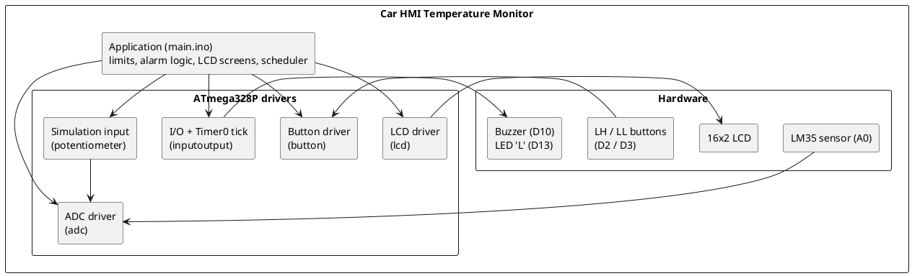
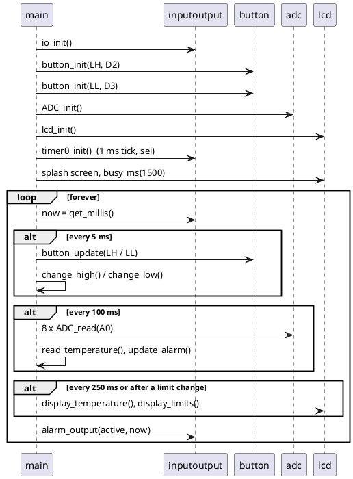
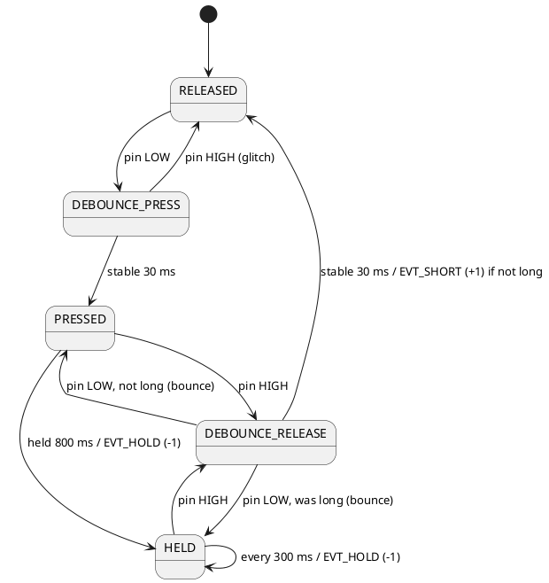
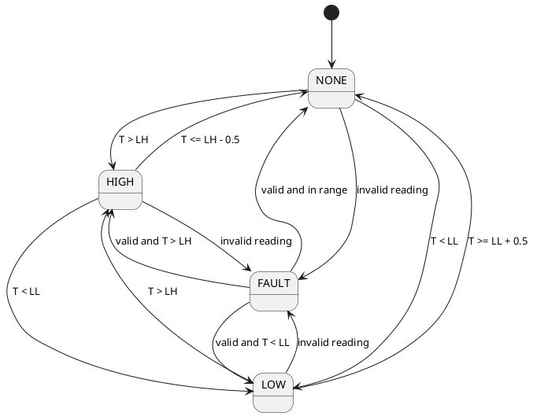
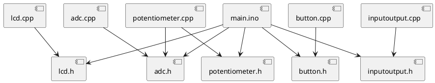

# Detailed Design Document — Car HMI Temperature Monitor

| **Authors** | Jana Mohamed (202401312), Hagar Ahmed (202400574), Maya Mohamed (202400179) |
|:--|:--|
| **Module** | KH5048CEM Embedded System Design & Development — Element 2: HMI |
| **Status** | Final |
| **Version** | 1.0 |
| **Date** | 19 November 2026 |

## 1. Introduction

This document describes the design of a temperature-monitoring Human Machine Interface (HMI) of the
kind used on a car display. The system measures temperature with an **LM35** analogue sensor and shows
the reading, a status and two user-configurable limits on a **16×2 LCD**. When the temperature leaves
the permitted range, or the sensor fails, a **buzzer** and an **LED** warn the driver.

### 1.1 Purpose

The system lets an operator monitor temperature and set a **Low limit (LL)** and a **High limit (LH)**
with two push buttons:

* The LCD shows the current measurement and whether it is inside the limits.
* The buzzer gives an audible warning, and the LED a visual one.

### 1.2 Scope

The design covers:
- Analogue temperature acquisition using the ATmega328P 10-bit ADC, with an 8-sample average.
- Conversion from ADC counts to tenths of a degree Celsius using integer arithmetic.
- LCD output in 4-bit parallel mode (HD44780).
- Two push buttons. A tap raises the limit by 1 °C; holding lowers it by 1 °C, repeating while held.
- An alarm (LED and buzzer) with 0.5 °C hysteresis and sensor-fault detection.
- A 1 ms system tick from Timer0, so the main loop never blocks.
- Modular, register-level software with no Arduino functions and no external libraries.
- An optional simulation mode, in which a potentiometer on A1 replaces the LM35.

Not included: humidity or light sensing, wireless communication, data logging, automatic calibration,
and storing the limits in EEPROM.

## 2. Architectural Overview

The software has two layers:
* **Application (`main.ino`):** decides what happens. It reads the sensor, applies the button events
  to the limits, evaluates the alarm and builds the LCD text.
* **Driver modules:** each module owns one piece of hardware and is the only code that touches its
  registers.



### 2.1 Hardware connections

| Component | Connection |
|---|---|
| LM35 output (middle leg) | A0 / ADC0 / PC0 |
| LM35 supply | left leg +5 V, right leg GND (flat face toward you) |
| LCD RS (pin 4) | D8 / PB0 |
| LCD Enable (pin 6) | D9 / PB1 |
| LCD D4, D5, D6, D7 (pins 11–14) | D4, D5, D6, D7 / PD4–PD7 |
| LCD RW (pin 5) | GND (write only) |
| LCD VSS / VDD (pins 1 / 2) | GND / +5 V |
| LCD V0 (pin 3) | wiper of a 10 kΩ potentiometer (outer legs +5 V and GND) |
| LCD backlight A / K (pins 15 / 16) | +5 V through 220 Ω / GND |
| High-limit button (LH) | D2 / PD2 to GND |
| Low-limit button (LL) | D3 / PD3 to GND |
| Active buzzer (+) | D10 / PB2 |
| Alarm LED | D13 / PB5 (on-board LED "L") |
| Simulation pot (optional) | A1 / ADC1 / PC1 |

Each button is wired across two **diagonally opposite** legs, so it works whichever way it sits in
the breadboard.

### 2.2 Assumptions and constraints

- The microcontroller is an ATmega328P running at 16 MHz.
- The ADC reference is AVCC (5.0 V) and the ADC prescaler is 128, giving a 125 kHz ADC clock.
- The LM35 output is 10 mV per °C. In the basic circuit it cannot measure below about 2 °C.
- The LCD is a standard HD44780-compatible 16×2 display in 4-bit mode. RW is tied to GND, so the
  busy flag is not read and fixed, generous delays are used instead.
- The buttons are active-low and use the internal pull-up resistors.
- The buzzer is an active type and is driven directly from the pin. Its current (under 30 mA) is
  within the ATmega328P pin rating.
- The default limits are LL = 15 °C and LH = 35 °C. They are kept in RAM, so they reset at power-off.
- Sensor accuracy (±0.5 °C), ADC resolution (about 0.49 °C per step), the AVCC tolerance and
  breadboard contact noise all affect the displayed temperature.

## 3. Functional Description

### 3.1 Startup

The firmware initializes, in order:
1. the I/O outputs (LED and buzzer),
2. the two buttons (inputs with pull-ups),
3. the ADC,
4. the LCD,
5. the Timer0 1 ms tick.

The LCD is started **before** the timer, because its delays are busy-wait loops that need no
interrupts. The screen shows "Car HMI Temp / Starting..." for 1.5 s, and then the main loop begins.



### 3.2 Temperature acquisition

The ADC reads channel 0, which is connected to the LM35. It takes 8 readings and averages them to
reduce noise. Each 10-bit reading is between 0 and 1023. With a 5 V reference:

`Voltage (mV) = ADC_value × 5000 / 1024`

The LM35 produces 10 mV per °C, so the voltage in mV equals the temperature in tenths of a degree:

`Temperature (0.1 °C) = ADC_average × 5000 / 1024` (rounded)

The calculation is done in 32-bit integers, so no floating point is needed. The result is shown with
one decimal place, for example `23.4C`.

**Sensor fault:** a reading above 150.0 °C is outside the LM35's range. It means the wire is loose or
shorted to 5 V, so it is reported as a fault. If an ADC conversion never finishes, the timeout makes
it return 1023, which is also treated as a fault.

### 3.3 Limit adjustment

Each button controls one limit. A non-blocking state machine, scanned every 5 ms, debounces the
button and decides between a tap and a hold:

| Action | LH button (D2) | LL button (D3) |
|---|---|---|
| Tap (released before 0.8 s) | LH + 1 °C, applied on release | LL + 1 °C, applied on release |
| Hold (0.8 s or longer) | LH − 1 °C, repeating every 0.3 s | LL − 1 °C, repeating every 0.3 s |

The limits always satisfy `0 ≤ LL` and `LH ≤ 99` (two digits on the LCD), and `LH − LL ≥ 1`. A
request that would break these rules is ignored, and both limits stay unchanged.



### 3.4 Alarm behaviour

The temperature T is valid when `LL ≤ T ≤ LH`. A value exactly on a limit is still OK.

| Condition | LCD status | LED | Buzzer |
|---|---|---|---|
| LL ≤ T ≤ LH | `OK` | off | off |
| T > LH | `HIGH` | on | beeping (0.5 s on / 0.5 s off) |
| T < LL | `LOW` | on | beeping |
| Sensor fault | `SENSOR FAULT !!` | on | beeping |

**Hysteresis:** once an alarm is active, it only clears when the temperature is 0.5 °C back inside
the range (T ≤ LH − 0.5 after HIGH, T ≥ LL + 0.5 after LOW). This stops the buzzer switching on and
off when the reading sits on a limit. A sensor fault has priority over every other state.



### 3.5 Display

Both lines are always written as a full 16 characters. This overwrites any old characters, so the
screen never needs a clear, which avoids flicker.

```
+----------------+
|Temp: 23.4C  OK |    status: OK / HIGH / LOW, or "SENSOR FAULT !!"
|LL:15C    LH:35C|
+----------------+
```

The LCD is refreshed every 250 ms, and immediately after a limit changes, so the buttons feel
responsive.

## 4. Implementation of the Modules

The software is split into modules so that each one can be understood, tested and changed on its own.

- **main (`main.ino`):** coordinates initialization and runs a time-triggered loop:
  * buttons every 5 ms
  * sensor and alarm every 100 ms
  * LCD every 250 ms
  * alarm outputs on every pass

  It also holds the limit rules, the alarm state machine and the LCD screen layout.
- **ADC (`adc`):** configures the ADC (AVCC reference, prescaler 128) and returns a conversion for a
  selected channel. It reads ADCL before ADCH and uses a timeout so the program cannot hang.
- **LCD (`lcd`):**
  * sets up its own pins and runs the HD44780 4-bit initialization sequence
  * provides command, character, string, cursor and right-aligned number functions
  * contains busy-wait delays that work without interrupts
- **Buttons (`button`):** configures the inputs with pull-ups and runs the debounce / tap / hold state
  machine. It returns `EVT_SHORT`, `EVT_HOLD` or `EVT_NONE`.
- **I/O (`inputoutput`):**
  * configures the LED and buzzer outputs
  * drives the alarm pattern (LED steady, buzzer beeping)
  * provides the Timer0 CTC 1 ms tick (16 MHz / 64 / 250) and an interrupt-safe `get_millis()`
- **Potentiometer (`potentiometer`):** reads a pot on A1 and maps it to 0–100.0 °C. It is used only
  when `USE_POT_SIMULATION` is 1.

The code accesses AVR registers directly: `DDRx`, `PORTx`, `PINx`, `ADMUX`, `ADCSRA`, `ADCL`, `ADCH`,
`TCCR0A`, `TCCR0B`, `OCR0A`, `TIMSK0` and the `TIMER0_COMPA` interrupt. It uses no Arduino functions
(`analogRead`, `digitalWrite`, `millis`, `delay`), no `util/delay.h` and no LCD library.

**Robustness measures:**
* All timing uses wrap-safe unsigned subtraction `(now − start)`.
* The 32-bit tick is read with interrupts briefly disabled.
* Limit arithmetic is done in `signed int` before narrowing.
* The button state machine has a `default:` recovery for a corrupted state.
* `lcd_number()` clamps its width to the buffer size.

## 5. Integration and Configuration

### 5.1 Static files

| File | Responsibility |
|---|---|
| `main.ino` | Application: settings, limits, alarm logic, LCD screens, main loop |
| `adc.h` / `adc.cpp` | ADC declarations / initialization and conversion |
| `lcd.h` / `lcd.cpp` | LCD declarations / 4-bit HD44780 driver and busy-wait delays |
| `button.h` / `button.cpp` | Button declarations and event codes / debounce and tap-hold state machine |
| `inputoutput.h` / `inputoutput.cpp` | LED, buzzer and Timer0 declarations / output control and 1 ms tick |
| `potentiometer.h` / `potentiometer.cpp` | Simulation input declarations / pot on A1 mapped to 0–100 °C |

The driver modules are `.cpp` files, so the Arduino IDE compiles each one separately. Only `main.ino`
goes through the IDE's sketch processing.

### 5.2 Include structure



### 5.3 Configuration

| Name | Value | Description |
|---|---:|---|
| CPU clock | 16 MHz | ATmega328P crystal |
| ADC reference | AVCC (5 V) | `REFS0 = 1` |
| ADC prescaler | 128 | 125 kHz ADC clock |
| LM35 channel | ADC0 (A0) | `ADC_CH_TEMP` |
| `ADC_SAMPLES` | 8 | readings averaged per measurement |
| `SENSOR_MAX_X10` | 1500 | above 150.0 °C = sensor fault |
| Initial lower limit | 15 °C | `LL` |
| Initial upper limit | 35 °C | `LH` |
| `LIMIT_MIN` / `LIMIT_MAX` | 0 / 99 °C | allowed limit range |
| `LIMIT_GAP` | 1 °C | minimum LH − LL |
| `HYSTERESIS` | 5 (0.5 °C) | alarm release margin, in tenths of a degree |
| `DEBOUNCE_MS` | 30 ms | stable time before a press or release is accepted |
| `LONG_PRESS_MS` | 800 ms | hold time before decreasing |
| `REPEAT_MS` | 300 ms | repeat period while held |
| `BUTTON_PERIOD_MS` | 5 ms | button scan period |
| `SENSOR_PERIOD_MS` | 100 ms | sensor and alarm period |
| `DISPLAY_PERIOD_MS` | 250 ms | LCD refresh period |
| `BEEP_MS` | 500 ms | buzzer on/off time during an alarm |
| Timer0 | CTC, /64, OCR0A = 249 | 1 ms interrupt |
| LCD mode | 4-bit | RS = PB0, E = PB1, data PD4–PD7 |
| Button inputs | PD2 (LH), PD3 (LL) | active-low with pull-ups |
| Outputs | PB2 buzzer, PB5 LED | active-high |
| `USE_POT_SIMULATION` | 0 | 1 = pot on A1 replaces the LM35 |

## 6. Verification and Test Strategy

The test cases are in `../test/HMI_manual_passfail.robot` in Robot Framework format. They are
operator-assisted: the tester applies each stimulus to the real board, observes the LCD, LED and
buzzer, and records PASS or FAIL.

| ID | Test | Expected result | Result |
|---|---|---|---|
| TC-01 | System Initialization | Splash screen, then the reading with `LL:15C  LH:35C` | PASS |
| TC-02 | Normal Temperature Reading | 25.3 °C, inside 15–35 °C, shows `OK`; alarm off | PASS |
| TC-03 | Low Temperature Alert | 10 °C, below LL, shows `LOW`; LED and buzzer on | PASS |
| TC-04 | High Temperature Alert | 40 °C, above LH, shows `HIGH`; LED and buzzer on | PASS |
| TC-05 | Increase High Limit Using D2 | Short press on D2 raises LH by 1 | PASS |
| TC-06 | Increase Low Limit Using D3 | Short press on D3 raises LL by 1 | PASS |
| TC-07 | Alarm Output Behavior | LED steady, buzzer beeping during an alarm; both off when back in range | PASS |
| TC-08 | LCD Contrast Adjustment | Turning the pot changes the contrast; text readable | PASS |

**Result: 8 tests, 8 passed, 0 failed.** Run with `py -m robot test/HMI_manual_passfail.robot`.

The demo video `test_prototype_video.mp4` (37 s) shows the system working on the real hardware:
* start-up and a steady reading
* LL raised until a `LOW` alarm appears, then cleared
* LH lowered until a `HIGH` alarm appears, then cleared

During bring-up, the prototype also exposed two hardware faults, which are recorded here as lessons
learned:
* **Floating A0 input:** a loose LM35 jumper made the reading jump between 0 and 44 °C. Fixed by
  re-seating and replacing the jumper wires.
* **Button always pressed:** a button whose permanently connected legs were wired to D3 and GND made
  LL count down on its own. Fixed by wiring diagonally opposite legs.

## 7. Limitations and Future Improvements

- Store the configured limits in EEPROM so they survive power-off.
- Replace the LM35 with an MCP9700A (−40 to 125 °C) to cover the automotive temperature range,
  including temperatures below 0 °C.
- Use a calibrated ADC reference, or measure the real AVCC, to improve accuracy.
- Add a hardware test interface (for example UART commands) so the Robot Framework tests can drive
  the inputs and read the results automatically.
- Add a transistor driver for the buzzer, and enable the watchdog timer and brown-out detection, for
  a production version.
- Add test cases for the hold-to-decrease function and for limits that cannot cross.
